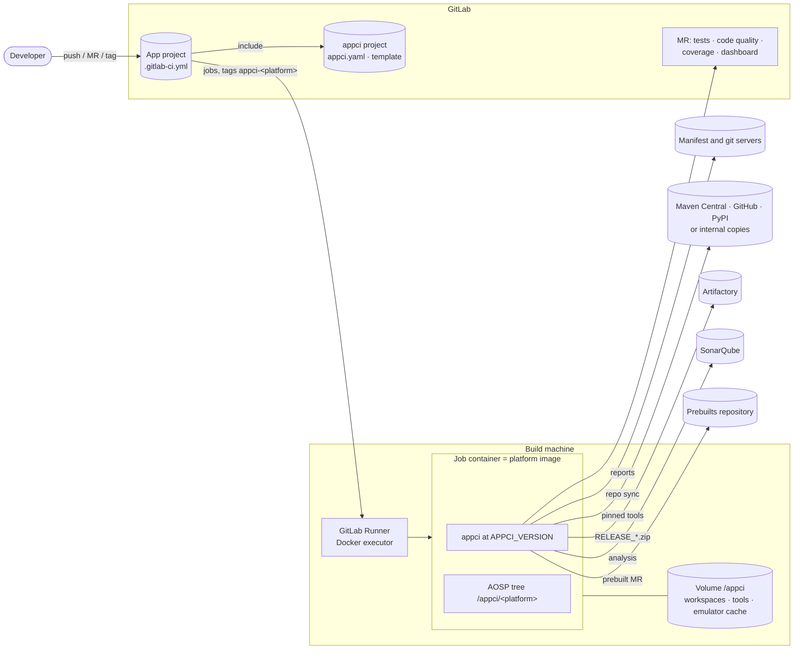
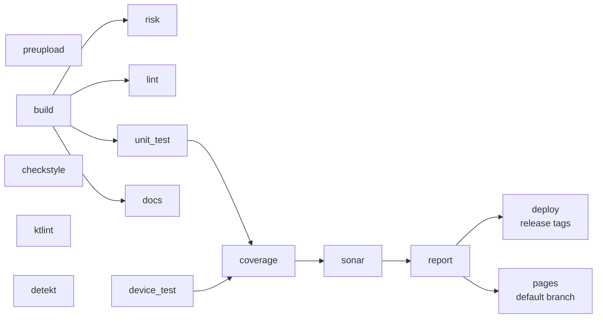
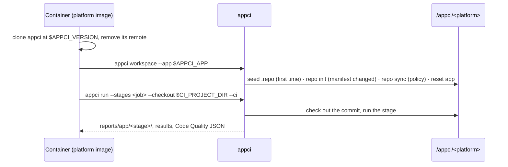
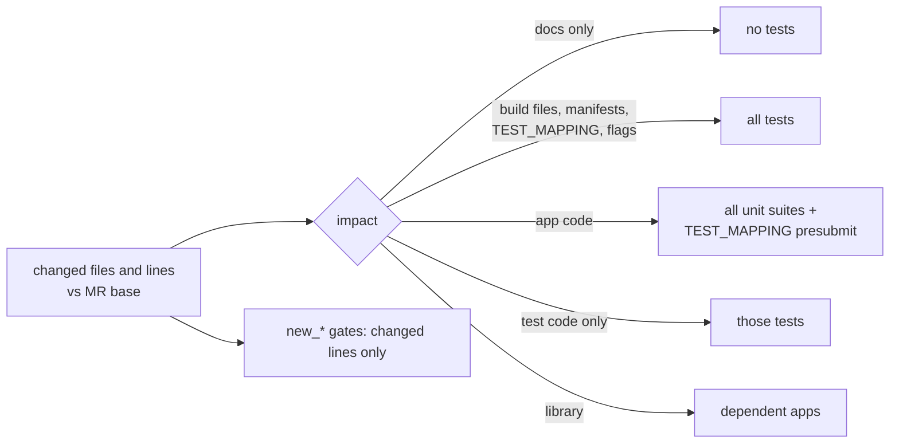
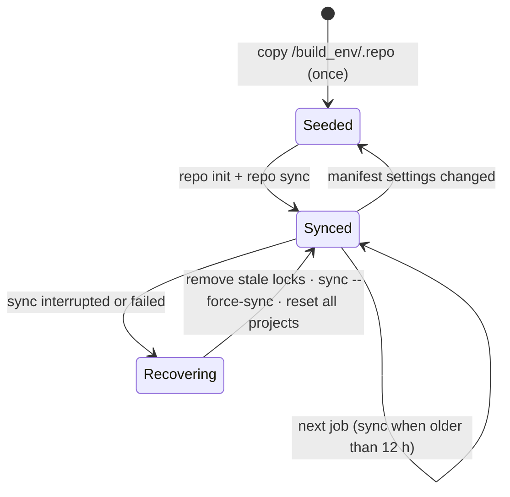

# appci architecture

How appci works inside. Setup and operation: [admin guide](admin-guide.md). Using it:
[developer guide](developer-guide.md).

## 1. Design

* **Build like the product.** Apps are built by Soong in the real platform tree, platform-signed,
  not with Gradle stand-ins.
* **Nothing to write per app.** Modules, test suites, sources and classpaths come from Soong's
  metadata (`module-info.json`, `module_bp_java_deps.json`).
* **Judge the change.** Static-analysis gates count only findings on lines the MR adds or
  modifies, so code with many old findings can adopt CI at once.
* **Official tools and reports.** Each analyser runs as its own CLI and keeps its own HTML report;
  appci adds one dashboard.
* **Platform images unchanged.** Jobs need Python 3.8+ with PyYAML and git in the image; appci is
  cloned per job, everything else comes from the tree or is downloaded pinned.
* **Fail closed.** If the change cannot be computed, a result cannot be parsed or a tool
  crashes, the job fails or reports *not run*; it never passes silently.

## 2. System



## 3. Code

| Module | Responsibility |
|---|---|
| `cli.py` | Commands (section 9). In CI it removes secrets from the environment first. |
| `config.py` | Defaults merged with `appci.yaml`, the platform section, CI variables and `--set`. |
| `workspace.py` | The platform tree on the runner volume: seed from the image's `.repo`, `repo init/sync`, recovery after interrupted syncs, `--repair`; checking the commit under test out into the app project. |
| `context.py` | Per app and run: profile, change set (changed files and lines), impact, report folders. |
| `discovery.py` | App profile from Soong metadata: apps, libraries, test suites, sources. |
| `impact.py` | Which unit and device tests (and dependent apps) a change affects. |
| `aosp.py` | Lunch targets with their own `OUT_DIR`, `m`, `atest`, paths, locks per `OUT_DIR`. |
| `stages/` | One class per stage; `stages/__init__.py` runs them, skips dependents of failed stages and evaluates gates. |
| `model.py` | Stage results, findings, gates, "new on changed lines". |
| `reports/` | Dashboard, JUnit, Code Quality JSON, Cobertura, tool HTML with official stylesheets, job-log output. |
| `tools.py` | Pinned third-party tools: version, URL, SHA-256, verified on every use. |
| `artifacts.py` | Emulator releases from Artifactory or any HTTP/local folder, checksum-verified and cached. |
| `emulator.py` | Headless emulator: boot, wait, shut down. |
| `javaenv.py` | Classpaths and class folders from Soong outputs (Javadoc, Dokka, Sonar). |
| `gitlab.py` | Generates `ci/gitlab/app-pipeline.yml`. |
| `util.py` | Processes with logs and progress lines, locks, secret handling and redaction, safe XML. |
| `java/PlantUmlDoclet.java` | Javadoc doclet writing PlantUML class diagrams. |
| `java/Xslt.java` | Applies an official XSLT stylesheet with the JDK's processor. |

One `appci run`: load config → find tree and app → profile → change set → impact → for each
stage: run, evaluate the gate, write `results/<stage>.json` → dashboard and aggregates → exit
code (0 ok, 1 a stage failed, 3 device tests not run).

## 4. Pipeline



| Job | Needs | Runs | Blocks the MR | Timeout |
|---|---|---|---|---|
| `preupload` | — | always | yes | 3 h |
| `build` | — | always | yes | 8 h |
| `emulator_image` | — | schedule with `APPCI_EMULATOR_IMAGE=true`, or by hand | no | 10 h |
| `risk`, `lint` | build | always | yes | 3 h |
| `checkstyle`, `ktlint`, `detekt` | — | always | yes (ktlint findings are warnings) | 3 h |
| `unit_test` | build | always | yes | 5 h |
| `device_test` | — | always, on `-kvm` runners | yes; *not run* is a warning | 5 h |
| `coverage` | unit_test, device_test | always | yes | 3 h |
| `sonar` | analysis and tests | default branch; manual on MRs | no | 3 h |
| `docs` | build | default branch, schedules; manual on MRs | no | 3 h |
| `report` | all earlier jobs | always | — | 3 h |
| `deploy` | all earlier jobs passed | release tags | — | 8 h |
| `pages` | report | default branch | no | — |

Every job:



All jobs of a platform share `resource_group: appci-tree-<platform>` (one job per tree at a
time); appci also locks the workspace and each `OUT_DIR`. Each job uploads only its own reports;
`report` combines them into the dashboard.

## 5. Stages

| Stage | Tool | Output | Gate |
|---|---|---|---|
| preupload | AOSP repohooks on the MR's commits (Python 3.9+; a pinned standalone CPython and lxml wheel when the image has none) | hook log, findings | no failed hook |
| build | `m <apps> <tests> jacocoagent jacoco-cli` on the userdebug target, `m <apps>` on the user target | build logs, `<Module>-debug.apk` and `<Module>-release.apk` | both builds succeed |
| risk | appci: manifest, privapp allowlist, `Android.bp`, aconfig flags, secrets on added lines, tests touched, APK growth, API checks | risk report | no blocker, APK growth ≤ 10 % |
| lint | Android Lint through Soong (`m <module>-lint`) | lint HTML/XML | no new error |
| checkstyle | `prebuilts/checkstyle` with `android-style.xml` | XML, HTML | no new error |
| ktlint | `prebuilts/ktlint` with the AOSP `.editorconfig` | XML, HTML | never blocks |
| detekt | Detekt CLI with `config/detekt.yml` and a per-app baseline | SARIF, HTML | no new error |
| unit_test | `atest` Robolectric and host suites selected by impact, with JaCoCo | JUnit, HTML, JaCoCo | no failure |
| device_test | emulator, MR build installed over the system app, `atest` instrumented suites | JUnit, HTML, JaCoCo | no failure |
| coverage | line-level merge of all suites | HTML, Cobertura | ≥ 50 % of changed lines (from 10 changed lines) |
| docs | Javadoc with the PlantUML doclet, Dokka for Kotlin | HTML, SVG | none |
| sonar | sonar-scanner with classes, classpath, findings, coverage | Sonar project | none |
| deploy | `m` per variant, `aapt2`, generated `Android.bp` and allowlist, MR in the prebuilts repository | commit message, delivered files | release tags only |
| image | full emulator build with coverage instrumentation | system images | build succeeds |

Statuses: passed, warning (findings or *not run*, gate OK), failed (gate), error (tool or
infrastructure), skipped (not needed, or a required stage failed).

## 6. Change detection and gates



The change set is the diff between the MR base (`CI_MERGE_REQUEST_DIFF_BASE_SHA`) and the commit;
locally `--changed-since <ref>` plus uncommitted edits. If it cannot be computed in CI, the job
fails instead of running with the changed-line gates off. MR labels `full-ci` and `device-test`
widen the selection; `appci impact` explains it. Gates are `max_*` / `min_*` per stage; warnings
never block; tests and the build always count.

## 7. Workspaces and emulator



The workspace is created once per platform and machine and does not depend on later image
updates. appci refuses to manage a tree it did not create. State is kept in
`.repo/appci-workspace.json`, logs in `.appci-logs/`.

Emulator releases: newest `RELEASE_*.zip` in the configured folder → checked against the
published SHA-256 → cached in `/appci/emulator/<platform>/` → unpacked privately per job →
headless boot → MR coverage build installed → instrumented tests → coverage pulled from the device.

## 8. Tools and licenses

Downloaded on demand into the tools cache (pinned version and SHA-256, checked on every use):

| Tool | Version | License | Used by |
|---|---|---|---|
| Detekt CLI | 1.23.8 | Apache-2.0 | detekt |
| PlantUML (MIT edition) | 1.2025.4 | MIT | docs |
| Dokka CLI, base, Kotlin analysis; kotlinx-html; FreeMarker | 2.0.0; 0.9.1; 2.3.32 | Apache-2.0 | docs |
| Ant JUnit (report stylesheet) | 1.10.15 | Apache-2.0 | test reports |
| Checkstyle report stylesheet | 83fe7ba | LGPL-2.1 | checkstyle report |
| sonar-scanner CLI | 7.2.0.5079 | LGPL-3.0 | sonar |
| python-build-standalone CPython | 3.12.7 | PSF-2.0 | preupload, when the image has no Python 3.9+ |
| lxml wheel | 5.3.0 | BSD-3-Clause | preupload hooks |

Required in the image: Python 3.8+ and PyYAML (MIT). From the AOSP tree: Soong, Android Lint,
Checkstyle (LGPL-2.1), ktlint (MIT), atest and Tradefed, Robolectric (MIT), JaCoCo (EPL-2.0),
the JDK (GPL-2.0 with Classpath Exception), the emulator, repo and repohooks (Apache-2.0 unless
noted). Infrastructure: GitLab Runner (MIT), Docker (Apache-2.0), SonarQube Community (LGPL-3.0).
All run as separate programs; nothing is linked into the apps.

## 9. Command line

| Command | Purpose |
|---|---|
| `appci doctor` | check machine, tree, tools |
| `appci discover [--app P] [--scan DIR --write-config]` | an app's modules and suites, or find apps |
| `appci run --app P [--stages …] [--skip …] [--changed-since REF]` | run stages (`--all`: every enabled app) |
| `appci impact --app P` | explain the test selection |
| `appci workspace [--sync] [--repair] [--adopt] [--print]` | prepare the platform workspace |
| `appci image` | build the emulator image |
| `appci baseline --app P` | recreate the Detekt baseline |
| `appci report --report-dir D` | rebuild the dashboard |
| `appci fetch-baseline` | download target-branch reports (CI) |
| `appci gitlab --out F` | generate the pipeline template |
| `appci checkout --app P --source DIR` | put a commit into the tree's app project |
| `appci tools [--fetch]` | list or download the pinned tools |

Global options: `--config`, `--aosp-root`, `--workdir`, `--platform`, `--device-lunch`,
`--emulator-lunch`, `--set key=value`.

## 10. Files

```
appci/              Python package (section 3)
bin/appci           launcher
appci.yaml          configuration
config/detekt.yml   Detekt rules for AOSP Kotlin
baselines/<app>/    Detekt baselines
ci/gitlab/          generated pipeline template
ci/docker/          runner config example, setup-runner.sh
docs/               guides
tests/              unit tests: python3 -m unittest discover -s tests
.gitlab-ci.yml      self-test of this repository
```

Runner volume `/appci`: `<platform>/` (the tree, with `out/`, `out_appci_emu/`, `out/appci/`),
`.tools/` (pinned tools and wheels), `emulator/<platform>/` (releases).

Report folder: `index.html` (dashboard), `summary.json`, and per app `profile.json`,
`changeset.json`, `impact.json`, `results/<stage>.json`, `gl-code-quality-report.json` and one
folder per stage.

## 11. Extending

* **App:** an `apps:` entry and the app project's `.gitlab-ci.yml`.
* **Platform:** a `platforms.<name>` section and runners tagged `appci-<name>`.
* **Tool version:** change `version`, `url` and `sha256` in `appci/tools.py`.
* **Stage:** a `Stage` subclass in `appci/stages/` registered with `@register`, defaults in
  `config.py`, its place in `gitlab.py` (`STAGE_OF`, `NEEDS`); regenerate the template.
* Run the unit tests on Python 3.8 and a current Python before tagging.
